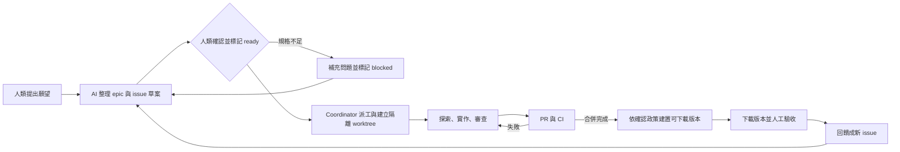

# Loop Engineering 前置建置計畫

> **提案日期：2026-10-18**
>
> **狀態：方向已確認；部分工具與包裝細節仍為提案或待盤點**
>
> 本文件記錄整體方向與分階段驗收。使用者已授權 #13 批次 issue 全部開工，依賴順序由一位 coordinator 配一位 worker 執行；目前本輪實作 #15 的文件／範本工作。各 issue 以其明確範圍為準。

| 分類 | 目前內容 |
|---|---|
| 已確認 | Windows 本機先行；一位 coordinator 配一位 worker；首張功能 issue 是 Hello App 依平台顯示 `Win`／`Mac`；有變更時每天台北時間 07:00 開始 Windows 與 macOS 包版；使用者自行下載試玩 |
| 提案 | GitHub Actions 負責兩平台包版及排程；以同一 main SHA 成功完成兩平台後發布 prerelease；依每日日期與 SHA 建立唯一版本標籤；Windows zip、macOS `.app` 壓縮包 |
| 待盤點／決定 | 本機實際可用的工具與啟動配置；Windows/macOS 打包所需依賴；Mac CPU 架構、簽章／公證、Release 保留政策；daily 變更判定細節 |

| 本批 issue | 目的 | 依賴 | 狀態 |
|---|---|---|---|
| #13 | Loop Engineering 建置 epic | 無 | `ready`；人類已授權本批開工 |
| #14 | 本機環境盤點與 doctor | 無 | `ready` |
| #15 | Issue／worker 共用契約與範本 | 無 | `in-progress`；本輪文件實作 |
| #16 | Worktree 操作與所有權 | `depends on #15` | `ready` |
| #17 | Verify 與工作入口 | `depends on #14`、`#15`、`#16` | `ready` |
| #18 | Hello App 平台文案 | `depends on #17` | `ready` |
| #19 | 有界 harness／恢復 | `depends on #17` | `ready` |
| #11 | 每日包版 | `depends on #17` | `ready` |

Issue #14–#19 是 #13 的子 issue，#11 也已納入此批並依賴 #17。這批 `ready` 狀態來自人類對指定批次的當次明確授權；不代表之後建立的 AI issue 可略過人類確認。#15 領取後為 `in-progress`。

## 1. 目的與範圍

本 repository 是協作與交付流程的範例；目前可執行的 Hello App 是目標程式。真正的 XQNextGPUI 位於公司內部，本工作區看不到其程式碼、服務端點或認證設定。因此，先把可公開重現的協作閉環做好，再以相同契約評估內部系統的移植方式。

目標是讓人類與多種 AI agent 能透過 GitHub issue、分支、Pull Request（PR）及隔離的 Git worktree，逐步提出需求、拆解任務、實作、審查、合併、發布與驗收。流程不綁定目前已存在的 issue，也不假設某一種 AI CLI、雲端服務或公司內部 API 已經可用。

這份計畫涵蓋協作方式、可靠狀態、初步自動化方向、平台交付及後續驗證。使用者已授權本批 issue 開工；未提供的 API、參數、效能基線或涉及憑證的發布條件仍不得自行猜測，並不把此批次延伸到所有產品功能。

本次依據：`AGENTS.md`、`README.md`、根目錄個人筆記 `Readme.txt`、`docs/handoff/handoff_20261018.md`、`docs/loop-engineering.md`、現有 CI 與 GitHub issue／PR 狀態。個人筆記只讀不改；其中 GitLab 的歷史描述不改變本範例目前使用 GitHub 的決定。使用者所說的「git tree 多線開發」，本提案按 Git worktree 規劃；它不是另一套版本控制系統。

## 2. 現況與缺口

目前 repository 已有 Rust workspace 與 Hello App，包含 `app`、`ui`、`quote`、`xtask`；依賴方向與模組責任已有文件說明。現有 CI 覆蓋 Windows 與 macOS，開發者可用 `cargo xtask debug-setup` 產生 VS Code 除錯設定。

使用者觀察到目前 Mac 畫面顯示 `Win`。Explorer 對目前 main 的 `main.rs` 檢視結果是固定顯示 `Hello` 與副標，沒有平台文案。這兩項是不同來源的資訊：前者是使用者實際觀察，後者是目前主線程式碼證據；首輪 issue 應先讓平台文案明確可見，並記錄所驗收 commit。Windows 本機可直接執行驗收；Mac 畫面須由 macOS CI 提供建置／測試證據，並由 Mac 真機附畫面人工驗收。CI 通過不能代替 GUI 驗收。

交接與 Loop Engineering 文件記載了從 issue、分支、完整驗證，到 PR、自動合併、回報與交接的基本路徑。分支保護和 PR 規則也已有記錄。這些是既有基礎，執行前仍應以 GitHub 當下狀態確認，不把文件記載當作外部狀態已驗證。

主要缺口是如何把抽象願望整理成可驗收的小 issue、如何拆分任務與宣告檔案所有權、如何開始及恢復隔離 worktree、如何避免重複領單，以及如何用一致命令啟動、驗證與回報一個工作回合。目前也沒有可界定重試、逾時、checkpoint 與暫停行為的 agent 執行器或 harness。

交接檔記錄的 #5／PR #12 debug 實作已合併，但 VS Code GUI 人工驗收尚未完成；不要把程式碼合併或 CI 綠燈寫成 GUI 已驗收。交接當時 #9–#11 尚未 `ready`；本次授權已將 #11 納入建置批次並標 `ready`。Issue 狀態可能繼續變動，以實際 issue 及交接紀錄為準。

## 3. 設計原則

1. **先讓閉環可人工完成，再逐步自動化。** 每一階段都應有可觀察的結果與明確失敗復原方式。
2. **Issue 是工作契約。** 目標、驗收條件、依賴及允許範圍先寫清楚，`ready` 才表示可以派工。
3. **GitHub 是跨工具的持久協作介面。** Claude、Codex、Gemini、Grok 不必共享聊天紀錄；必要決策、證據及下一步應能從 issue、PR 與交接檔接續。
4. **每項工作都能追溯。** issue、owner、run-id、branch、worktree、base/head SHA、PR 與驗證結果互相對得起來。
5. **狀態不靠單一 label 推斷。** Issue label、issue 留言、PR 狀態、CI 與實際 merge 結果各自表達不同事實。
6. **失敗可停止、可恢復。** 保留有未提交或未推送工作的 worktree；不可因逾時就刪除或搶走工作。
7. **工具能力如實揭露。** 未實作的命令或 provider adapter 只列為設計名稱，不呈現為已可執行功能。
8. **先保護私人資料。** 不把內部網址、token、公司資料或本機登入資訊放入 repository、issue、日誌或交接檔。

## 4. 建議的端到端閉環



### 4.1 人類提出方向

人類以簡短願望描述問題、使用情境、預期結果及限制。AI 可協助補成一份 epic 與一組小 issue 草案，但不得把尚未確認的猜測寫成需求。規格不足時提出選項與推薦，等待人類決定；相關 issue 保持未 `ready` 或標為 `blocked`。

### 4.2 拆解並確認 issue

每張可執行 issue 至少應包含：

- 使用者問題與明確目標。
- 非目標及本次不處理的內容。
- 輸入、輸出、錯誤行為或 UI 行為；適用時附例子。
- 可觀察、可重現的驗收條件。
- 相依 issue，並使用 `depends on #N` 表達。
- 允許修改的檔案或模組範圍，以及不可觸碰的敏感區域。
- 必要驗證指令、人工驗收步驟與應附證據。
- 負責的協調者／worker 或待派工狀態。
- 預期 PR、issue 關閉條件與完成後的回報方式。

AI 建立的 issue 加上 `ai-created`；人類 issue 視為可進入排程，但規格不完整仍須先釐清。人類在 issue 層確認目標和驗收條件後加上 `ready`；`needs-review` 是等候人工驗收，不能當成可重新領取開發工作的標記。

### 4.3 協調者派工與隔離

第一版由一位 coordinator 指派給一位 worker，依既定優先順序挑選 `ready` issue，確認相依已完成，然後記錄 owner、run-id 與 branch，再啟動工作。初期固定為 1 coordinator + 1 worker；平行任務另選獨立工作，不提高首輪人數。

每個 issue 的工作使用一個 branch、一個 worktree、一個 owner 及一個 run-id。分支名稱可採 `codex/issue-N-short-description` 作為示例；其他 AI 工具依 repository 規則選擇相容命名。Worktree 位置由本機設定決定，不把任何使用者磁碟路徑寫死在工具或文件中。

GitHub label 不是原子鎖；加上 `in-progress` 本身不能保證兩個 coordinator 不會同時派工。派工順序應是先確認唯一 owner 與執行紀錄，再啟動工作，並記下領取時間及 run-id。逾時只代表需要檢查，不代表可直接搶單；必須確認舊 owner 已停止，或由人類明確解除，再交給新 owner。

Worktree 的檔案彼此隔離，但 Git metadata 由同一 repository 共用；初期 `target` 目錄各自獨立，不共享建置產物。涉及 `Cargo.lock`、根目錄 Cargo 設定、`AGENTS.md`、CI 等共用檔案時，先集中由 coordinator 整合，或序列化處理，不讓平行 worker 同時修改。

生命週期依序為：抓取最新 `origin/main` → 確認派工與工作區權限 → 從該 SHA 建立 issue 分支與 worktree → worker 只在自己的工作區操作 → 本機驗證與 PR → 確認實際合併 → 檢查沒有未提交、未推送或未保存資料 → 回收該 worktree 與已合併分支。不可在別人的工作區切分支，也不強制刪除有殘留工作的目錄。

### 4.4 探索、實作與審查

Explorer 只讀探索，回報相關檔案、現況、約束與風險，不修改程式。Coordinator（Sol）決定根因、方案與驗收界線，再將有限範圍交給 implementer（Luna，高推理）實作。完成後由 coordinator 審查差異與驗證證據；發現不符合時交回具體修正項目。

上述模型分工適用 Codex 內部，依目前指示使用 Sol 協調、Luna 執行；例外升級依既有 orchestration policy，不因單次測試失敗就升級。跨 Claude／Gemini／Grok 的任務同樣遵守範圍與證據契約，但不假設它們支援同樣的子 agent 或模型選項。

Worker 不自行挑選其他 issue，不擴大任務目標，也不修改協調者指定範圍外的共用檔。若實作中發現規格缺漏或必須改變驗收條件，先將該 issue 記為 `blocked` 並寫明選項，同時只在不依賴此決定的範圍內繼續工作。

### 4.5 PR、合併與發布

驗證通過後推送分支並建立 PR，列出行為、測試及任何人工驗收需求。符合全部關閉條件時引用 `Closes #N`；尚需人工驗收時只引用 `Refs #N`，保留 issue 等待驗收。可依 repository 流程啟用 auto-merge；CI 綠燈不等於 PR 已合併。Coordinator 必須讀取實際 PR 狀態、`mergedAt` 或等價資訊及 merge commit SHA，才可回報已合併。

合併失敗、衝突或 CI 失敗時，回到同一 PR 修正並重新驗證；不 force push、不重複開 PR。若 PR 已建立但工作中斷，恢復前先查 issue、branch、worktree 及遠端 PR，沿用原有工作，不重複發留言或另開 PR。

每次合併的 issue 回報應記錄 PR、merge commit、驗證結果與後續事項。若尚需人工 UI 驗收，issue 留在 `needs-review`，不得以 `Closes` 提前關閉。驗收通過後，再以可追溯方式標記完成或關閉。

使用者自行下載發行版本並試玩，收到回饋後回到新 issue 循環。已確認每日台北時間 07:00 開始包版，包含週末；這是開始執行的時間，不保證 07:00 當下即有可下載版本。建議由 GitHub Actions 的 Windows 與 macOS runner 各自產出對應平台版本，避免把本機 Windows 誤當成可建置 Mac app 的環境。GitHub 官方文件指出排程工作可能延遲，負載高時尤其如此；可使用 `schedule.timezone` 設定時區，概念排程為 `cron: '0 7 * * *'`、`timezone: 'Asia/Taipei'`。詳見[官方 schedule 事件文件](https://docs.github.com/en/actions/reference/workflows-and-actions/events-that-trigger-workflows#schedule)。排程目前尚未實作。

「有變更才包版」已確認，具體判定、發布及包裝格式尚屬提案。建議以 main 本次快照 SHA 和上次完整成功 daily release SHA 比較：第一次沒有成功基準時執行包版；SHA 相同時跳過；包版失敗不更新基準；兩平台針對同一 SHA 的 checks 與包裝都成功才建立 GitHub Releases prerelease；daily run 進行中若 main 前進，新 SHA 留給下一次排程處理。此預設將 main 上的新 commit（含純文件變更）都視為變更，是否排除純文件可後續調整。每日 tag 可由日期和 SHA 組成以保持唯一，另以發布互斥控制及已存在版本檢查，避免手動觸發與排程重複建立同一版本。此判定尚待使用者採納。

包裝提案為 Windows zip（執行檔、必要資源／相依及版本說明，解壓後啟動，初期不做 installer），macOS `.app` bundle 再壓成 zip，日後再評估 dmg。Apple 說明列出 zip 與 dmg 等發行方式，詳見[Packaging Mac software for distribution](https://developer.apple.com/documentation/xcode/packaging-mac-software-for-distribution)。zip 不代表可略過 Gatekeeper、安全簽章或公證要求；簽章、公證、Intel／Apple Silicon 支援範圍、產物保留時間，留到 Release 實作前決定。這些未知項不阻塞首輪平台文字。

交接內容優先併入當前 issue 的 PR，記錄當時可驗證的事實；最終 merge SHA 在合併後寫入 issue 留言，下次正常更新交接時再補記。不為了讓交接檔包含自己的最終 merge SHA 而反覆另開 PR。若本輪結束確有未併入的交接內容，才依規則開交接 PR。

## 5. 狀態與恢復紀錄

不新增一堆 label 代表每個細部階段。沿用現有 `ready`、`in-progress`、`blocked`、`needs-review` 等 label，搭配 issue 內容、PR 與 CI 的真實狀態表達其餘資訊。計畫階段、待派工及已接受發布等狀態可在 issue 或發行紀錄中清楚描述，待實際使用證明需要時再決定是否加工具支援。

每次執行在 issue 留言或後續選定的紀錄位置保留一個 checkpoint，至少包含：

| 欄位 | 用途 |
|---|---|
| run-id、issue、owner | 辨識工作及目前負責者 |
| branch、worktree 對應 | GitHub 記錄工作區代號；實際絕對路徑留在本機，避免公開個人或公司路徑 |
| base SHA、目前 head SHA | 確認起點與工作進度 |
| PR URL、CI／review 狀態 | 恢復既有 PR，不建立重複 PR |
| 上次動作與時間 | 區分暫停、失敗及可能仍在執行 |
| 下一步與阻塞原因 | 讓接手者直接延續 |

重跑前先讀 checkpoint，再檢查 GitHub 與本機狀態。若工作區有未提交變更或分支有未推送 commit，保留並報告，不直接清理。若無法確認舊 owner 已停止，暫停派工並將事實記錄下來；若遠端 PR 已存在，接續同一 PR。必要時由人類解除 owner 或決定放棄，並留下明確記錄。

## 6. 前置建設清單

這些工作是建立可重複閉環的實際缺口，依優先序分批完成；不要求每項都等人工決定才開始。AI 可以先盤點本機環境、整理範本與擬定可驗收規格；只有牽涉使用者需求語意、帳號登入或憑證、發布政策及安全設定時，才需要人類補充或選擇。

| 優先 | 項目 | 已有／已知 | 待補工作 | 交付物 | 完成條件 | 相依／需要人類決定 |
|---|---|---|---|---|---|---|
| 1 | 本機環境盤點與 `doctor` | 已盤點到 Windows x64；`git`、`cargo`、`rustc`、`gh`、`codex`、`claude`、`gemini`、`grok` 有命令入口；Cargo／Rust 1.94.1 | 確認版本和工作目錄，辨識缺少的必要工具；`doctor` 先檢查指令與版本，不讀取或輸出機密 | 盤點結果及可重複執行的 `doctor` 規格／小工具 | 在 Windows 回報每個檢查項成功、失敗或未檢查，能指出修復步驟 | 可先由 AI 完成；上述證據不代表 AI 已登入、非互動呼叫／預算可用，也未驗證 Windows SDK |
| 2 | Issue 需求、blocked 與回報範本 | `AGENTS.md` 已定義 `ready`、`in-progress`、`blocked`、`needs-review` | 把目標、非目標、驗收、依賴、檔案範圍、驗證、人工畫面證據與回報欄位化 | 繁中 issue 範本／範例；首張平台文案 issue | 一張 issue 可由不同 agent 獨立理解並判斷是否通過；規格不足時可回報問題和下一步 | AI 可先寫草案；平台文字及實際呈現條件已由使用者指定 |
| 3 | Worktree 操作與所有權 | Git worktree 已納入流程設計，分支／PR 規則已記錄 | 定義建立、定位、狀態記錄、保留 dirty／未推送工作與安全回收步驟 | 一頁操作流程或小型 helper | 首輪 issue 能從最新 main SHA 建立隔離工作區並回到同一 branch；中斷後找到原工作，不誤刪 | 依賴 issue 已 `ready`；路徑可用本機設定決定 |
| 4 | AI 任務提示、provider 與啟動設定 | 多個 AI CLI 命令目前可見 | 先用 `doctor` 檢查允許工具；定義共享 worker 提示、輸入輸出契約及每個 provider 的非互動啟動設定 | 可版本控管的任務提示、provider 啟動設定範例與最小呼叫介面 | 至少一個使用者已允許的工具可以在指定範圍啟動一次 worker，失敗會明確回報且不洩漏憑證 | 可先盤點可執行性；帳號登入、工具政策、非互動模式、用量預算需在實際呼叫前確認，不儲存 token |
| 5 | Coordinator 派單狀態 | label 語意及 owner/run-id 原則已定義 | 建立單一 coordinator 派工紀錄，避免重複領單；逾時只檢查，不自動搶單 | issue 狀態／派工紀錄欄位與人工 runbook | 一位 coordinator、一位 worker 可唯一對應 issue、run-id、branch、worktree；恢復演練沿用同一工作 | 依賴 2、3；單機單 coordinator 是已確認起點，跨機鎖暫不需要 |
| 6 | 共用 build、test、UI 與人工驗收命令 | Cargo workspace 驗證指令、Windows／macOS CI 已有 | 統整一個入口或說明；分清 CLI 驗證、平台建置、GUI 畫面人工驗收及證據格式 | `verify` 規格／腳本與驗收證據清單 | Windows 本機可執行 CLI 驗證；Mac 由 macOS CI 提供建置證據，另附 Mac 真機畫面供人工確認；CI 不冒充 GUI 驗收 | 可由 AI 整理；Mac 真機驗收需有人能取得 Mac 畫面 |
| 7 | Checkpoint、retry、resume | checkpoint 必要欄位已列於第 5 節 | 定義失敗分類、有限重試、停止條件與恢復時遠端／本機檢查順序 | run-once／resume 操作規格和可恢復紀錄 | 中斷後能判斷已完成的步驟、沿用既有 PR、保留變更；重試用盡後停止並留下下一步 | 依賴 3、5、6；預算上限可先依任務時間設定，實際 provider 限制在第 4 項盤點 |
| 8 | Windows／macOS 包版與 Release | CI 已涵蓋 Windows／macOS；使用者已確認每日台北 07:00 開始包版、自己下載試玩 | 建置兩平台產物、同 SHA 判定、schedule、唯一 tag 與 prerelease；確認簽章、公證及保留政策 | Actions workflow、兩平台下載產物及簡短試玩／回饋說明 | 兩平台同 SHA 均成功才發布；失敗不推進基準；使用者可下載並回報版本 SHA | 可先由 AI 盤點及準備 workflow 草案；Mac 架構、簽章、公證、保留天數於發行實作前由人決定。依賴 6 |

前置項目 1、2 可先並行盤點；3、4、6 可依其輸入逐步準備；5 在 2、3 明確後落地；7 依首輪工作結果實作；8 可先準備 workflow 草案，但發布前需要實際平台包裝與政策決定。環境命令存在只代表可找到執行檔，不代表已完成登入或呼叫驗證。

## 7. 分階段實施與驗收

各階段的具體 issue 應在計畫獲確認後再建立；本表描述方向和每個階段的退出條件，不代表現在直接建立 issue。

| 階段 | 交付 | 可觀察驗收結果 | 失敗／復原方式與相依 |
|---|---|---|---|
| A. 確認方向 | 人類確認本計畫的範圍與起步選項；整理一個 Hello App 演練 epic 與小 issue 草案 | Epic、子 issue 的目標、依賴及驗收條件可由人類逐項確認；尚未確認的部分清楚標示 | 方向或規格不清就留在提案階段，列選項等待決定；不宣告開工。後續階段依賴 A |
| B. 平台文案單 worker 閉環 | 首張 issue 修改 Hello App，依執行平台顯示 `Win` 或 `Mac`；由一位 coordinator 派給一位 worker，完成 worktree、PR、合併及回報 | Windows 本機畫面顯示 `Win`；macOS CI 有該 commit 的建置／測試結果；Mac 真機畫面顯示 `Mac` 並附在 PR／issue；記錄 source 與驗收用 commit SHA。CI 綠燈不代表 GUI 已驗收 | 若 macOS CI 或 GUI 不符，留在原 PR 修；Windows 本機不能代替 Mac 真機驗收。Mac 暫不可取得時標為 `needs-review`，保留 issue 開放及證據待補 |
| C. 統一工作入口 | 定義並實作 doctor、plan、worktree、verify、run-once、resume 等命令或等效腳本的最小規格 | 新接手者依一頁說明可檢查環境、建立隔離工作區、執行驗證及恢復演練；錯誤能指出下一步 | 命令未具備時只以人工步驟完成，不得假裝已支援；保留原工作區並回報失敗點。依賴 B 的實際經驗 |
| D. 兩 worker 平行 | 以兩張互不依賴、檔案範圍不重疊的真實 issue 演練平行工作與整合 | 兩個 owner、run-id、worktree、branch、PR 可明確對應；沒有同時領同一 issue 或未授權共改檔案；各自完成驗收 | 發現共用檔衝突時停止其中一方的該部分，由 coordinator 序列整合；保存兩邊工作並按原 PR 收斂。依賴 B、C |
| E. 有界執行器／harness | 增加明確的重試、逾時、checkpoint、resume 與安全停止能力 | 最長一小時的受控試跑可在中途停下後恢復；日誌可辨識每次動作及結果；超時不會刪工作區或自動搶單 | 錯誤重試達上限後停止並留 checkpoint；人工可從 issue 和紀錄判斷是否恢復。依賴 C、D；不以消耗 token 或長時間空轉作成功指標 |
| F. 每日可試玩發行 | GitHub Actions 每天台北時間 07:00 開始 Windows／macOS 包版，成功後發布 prerelease，使用者自行下載；週末也執行 | 兩平台使用同一 main SHA 完成檢查與包裝後才發布；Release 含可辨識版本 SHA 和試玩資訊；使用者可下載並回報。排程實際開始／完成時間可從 workflow 與 Release 時間查到 | Actions 排程可能延遲，07:00 是開始時間；任一平台失敗不發布完整 release、不更新成功基準；workflow 進行時 main 前進則下一輪處理。依賴 6、8；包裝／簽章方案於開發 Release 前定案 |
| G. 內部系統移植評估 | 依同一協作契約評估 XQNextGPUI 的 adapter、CI 與資料保護需求 | 先由有權限者補足內部程式、API、網路、runner、認證與資料政策，再列可執行方案及驗收 | 資料或存取條件不足時只記錄缺口，不猜端點、不把內部資料帶入公開 repository；依賴人類提供可公開的規格與授權 |

建議順序是 A → B → C → D → E；F 在 B 完成後即可另線推進，先讓人有版本試玩。第一個里程碑是 B 加上 F 的手動發布：一張真實需求從提出到取得 Hello App 新版本，再由使用者回饋一張新 issue，完整繞回起點。每日排程則在手動發布驗收後啟用，無須等待 E 的長時間執行器完成。

E 的執行預算須同時包含最長時間、最大重試次數與可取得的用量資訊；停止後留下最後一個 checkpoint、未提交變更及下一步。無可用 token／context 數據時明確標示未知，以保守的時間及任務邊界提前交接，不宣稱能精確偵測剩餘百分比。

## 8. 首輪工作與後續拆分

第一張功能 issue 已確認為 Hello App 平台文案：Windows 執行顯示 `Win`，macOS 執行顯示 `Mac`。目前 main 的 `main.rs` 證據是固定 `Hello` 與副標；使用者回報 Mac 目前看見 `Win`。Issue 需讓平台字樣在畫面上可直接辨識，記錄驗收時的 commit SHA，並明確分開 Windows 本機檢查、macOS CI 結果及 Mac 真機 GUI 畫面驗收。若實際 Mac 畫面仍顯示錯誤，issue 不可只憑 CI 關閉。

這張 issue 不依賴 quote 或 ui 元件工作，也不與 #5 或 #9–#11 硬綁。1 coordinator + 1 worker 完成首輪後，平行演練另選需求與檔案範圍互不衝突的 issue，再由 coordinator 依實際衝突風險決定是否並行；候選工作須先有可驗收規格。

## 9. 命令與執行器方向

初期建議採本機單一 coordinator、GitHub issue／PR 作紀錄介面，以及使用者已安裝且可用的 AI 工具；先手動啟動，再以演練結果決定自動化範圍。可評估將穩定的 repository 操作放在 `xtask`，再以腳本呼叫 agent provider。Provider adapter 應只對已實際接通及驗證的工具宣稱支援，不把所有 CLI 當成同一種介面。

概念上的命令可以是：

| 命令概念 | 預期用途 | 初始狀態 |
|---|---|---|
| `doctor` | 檢查 Git、Rust、GitHub CLI、權限及必要工具是否可用 | 尚未實作 |
| `plan` | 讀取已確認 issue，產生範圍與驗收摘要供 coordinator 審查 | 尚未實作 |
| `worktree` | 建立或定位 issue 對應的隔離工作區 | 尚未實作 |
| `verify` | 執行該 issue 所需的驗證並保存結果 | 尚未實作 |
| `run-once` | 手動執行一次受控的派工／工作流程 | 尚未實作 |
| `resume` | 依 checkpoint 檢查並恢復原有 run | 尚未實作 |

GitHub Actions 目前適合負責 CI 和可重現的打包；在沒有明確的安全設計與授權之前，不應把私人 AI 登入或公司內部憑證放到 Actions。第一版的操作仍可由人類啟動本機流程，並由 PR 的 CI 提供跨平台證據。

C 先交付大家共用的建置／驗證入口與 worktree 操作，再做 `run-once`／`resume`，不要求一次實作表內所有命令。程式變更的驗證基線沿用現有 workspace 指令：

```bash
cargo fmt --all --check
cargo build --workspace --all-targets
cargo test --workspace
cargo clippy --workspace --all-targets -- -D warnings
```

只有文件變更時做文件差異、連結與格式檢查，依既有 CI 規則回報；UI 操作、畫面與效能驗收另附可重現步驟及證據，不能以編譯成功取代。

## 10. 使用者的一天如何操作

首輪操作為：人類提出需求或確認平台文案 issue；coordinator 檢查規格，AI 建立的 issue 由人類標記 `ready` 後才派工；人類啟動 Windows 本機工作；一位 coordinator 將 issue 交給一位 worker；Windows 本機驗收並由 macOS CI 建置；具備 Mac 時附真機畫面做 GUI 驗收；PR 合併後等有變更時的每日包版；人類自行下載 Windows／macOS 版本試玩並回饋新 issue。每天 07:00 是包版啟動時間，實際可下載時間以完成兩平台包裝及發布為準。

## 11. 願望與後續路線的關係

多條工作線與多 AI 命令協作先落在 issue、PR、owner、worktree 與 checkpoint 的流程設計，首輪由單 worker 開始，穩定後再升至兩個。跨平台先以既有 Windows／macOS CI 為基礎，其他平台要有實際環境證據才能納入承諾。

個人筆記提出的「頁面繪製低於 20 ms」目標，需要先釐清量測環境、繪製計時邊界、代表性操作及統計方式，再建立基線與可重現驗收；目前不擅自指定 p95 或其他統計作為規格。單元、UI 與 API 測試分別建立驗證方式，API 的回應時間不套用此繪製門檻。雲端自選／存檔與 Das 真 API 需要服務契約、資料政策及授權後才能拆解。

AI XS 回測、選股與下單先以 mock 或測試環境討論驗收，不把真實下單當成第一階段目標。語音與技術分析屬後續 epic；任何自動實盤能力都需另外定義風險、授權與驗收條件。本計畫把它們列為路線候選，不承諾本輪交付。

## 12. 待盤點事項與待決提案

首輪方向與平台文案目標已確認。下表是工具能力盤點或尚待採納的實作提案；它們不阻塞 issue 範本、環境盤點與首輪平台文字工作，僅在相應功能要落地時需要補齊。

| 類別 | 目前提案／已知事實 | 待盤點或待決事項 |
|---|---|---|
| 工具盤點 | Windows x64 上可找到 Git、Rust/Cargo、GitHub CLI 及 Codex／Claude／Gemini／Grok 命令入口 | 各 AI 是否已登入、支援哪種非互動呼叫、各自預算與政策；Windows SDK／打包相依。命令存在不代表可呼叫 |
| 每日 Release 判定（提案） | 第一次無成功 SHA 時包版；main SHA 與前次完整成功 SHA 相同則跳過；失敗不更新基準；兩平台同 SHA 成功才發布 prerelease；pending 中的新 main 留到下一輪 | 是否採此規則，手動觸發是否共用相同唯一 tag／去重行為 |
| 產物（提案） | Windows x64 zip，macOS `.app` zip；使用者自行下載；較簡單的初期格式，macOS 日後可評估 dmg | Mac Intel／Apple Silicon 範圍、簽章、公證、Gatekeeper 限制、Release 保留天數。這些在 F 實作發布前決定 |
| 效能後續 | 建立量測條件及基線後再拆驗收 | 20 ms 要量的操作、平台及統計方式；不影響首輪平台文案 |
| 內部 XQNextGPUI | 有權限者補契約與資料政策後評估 | 可供規劃的 API、程式、runner、網路及資料範圍 |

Repository 設定、分支保護、權限與 secrets 的修改不包含在本提案預設範圍內；若後續階段證明確有必要，須先另行說明修改內容、影響與復原方式，再由有權限者授權。

## 13. 建議的接續步驟

方向已確認後，coordinator 先落實前置清單第 1、2 項中不依賴額外授權的工作：記錄本機工具盤點範圍，建立首張平台文案 issue 草案及驗收證據欄位。首輪從 Windows 本機啟動，由一位 coordinator 指派一位 worker。Issue 可標 `ready` 後走單 worker worktree／PR 閉環；Mac GUI 驗收需取得真機畫面，若尚不可用，保留 `needs-review` 與 open issue，並持續完成不依賴該驗收的前置文件工作。

包版工作可在首輪功能合併後，按前置清單第 6、8 項準備 Windows／macOS workflow；daily schedule 在同 SHA 判定、失敗復原與兩平台產物均有可驗收實作後啟用。工作者 CLI、Mac 架構、簽章／公證及保留政策分別在其對應功能實作前補齊，不把所有未決項當成現在停工理由。先不建立泛用 agent 平台或跨機排程鎖；若未來確需多機 coordinator，再另提範圍與驗收。
